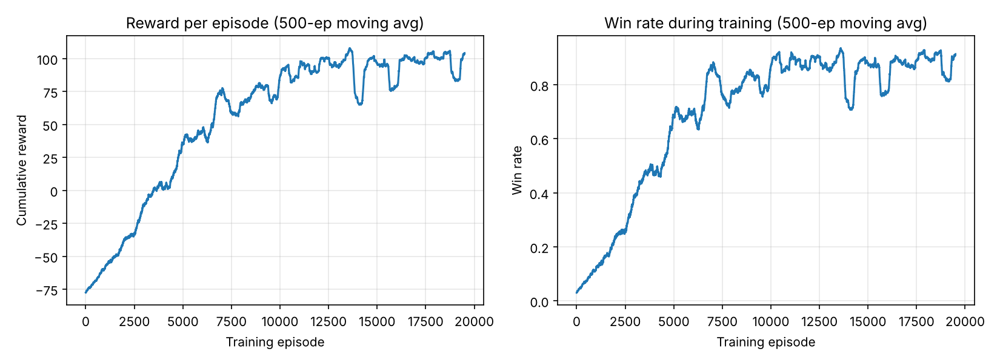

# Q-Learning Text Adventure Game

A text adventure framed as a sequential decision-making problem and solved with **tabular Q-learning** (Python, NumPy). The agent learns, purely from rewards, how to explore a dungeon, collect items, and defeat a dragon.



## The game

```
                Vault (dragon, locked)
                   |
 Swamp - Armory - Hall - Library - Garden
                   |
               Entrance
```

- **Items:** sword (Armory), potion (Swamp), key (Library), coin (Garden)
- **Goal:** enter the Vault with the key and beat the dragon
- **Randomness:**
  - Swamp has a 30% snake-bite chance on entry (-10 reward)
  - Dragon fight is probabilistic: sword + potion = 90% win, sword only = 60%, no sword = always lose

## RL formulation

| Component | Definition |
|---|---|
| State | (room, has_sword, has_potion, has_key, has_coin), 112 states |
| Actions | north, south, east, west, pickup |
| Rewards | -1 per step, +10 per key/sword/potion, +5 coin, -2 invalid move, -4 locked door, -10 snake bite, +100 defeat dragon, -50 dragon wins |
| Update rule | `Q(s,a) += α [r + γ · max Q(s',a') − Q(s,a)]` |
| Exploration | epsilon-greedy, ε decays linearly from 1.0 to 0.05 |

## Results

Trained for 20,000 episodes with learning rate α = 0.1 and discount factor γ = 0.95. Evaluated over 1,000 test episodes using the greedy policy.

| Agent | Win rate | Avg cumulative reward |
|---|---|---|
| Q-learning | 90.3% | 104.3 |
| Random baseline | 2.3% | -80.2 |

The learned policy collects the sword and potion before entering the Vault, which is the best strategy in this game, so ~90% is close to the maximum win rate the dragon's odds allow.

## Run it

```bash
pip install numpy matplotlib
python q_learning_adventure_v2.py
```

This trains the agent, prints the evaluation, shows a sample greedy playthrough, and saves `reward_curve.png`.

## Ideas for extension

- Replace the Q-table with a neural network (Deep Q-Network) to handle larger worlds
- Add more rooms, enemies, and items
- Compare SARSA vs Q-learning, or tune α, γ, and the ε schedule
